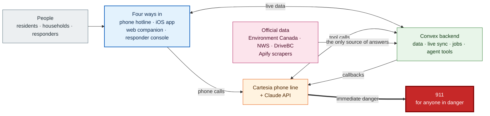
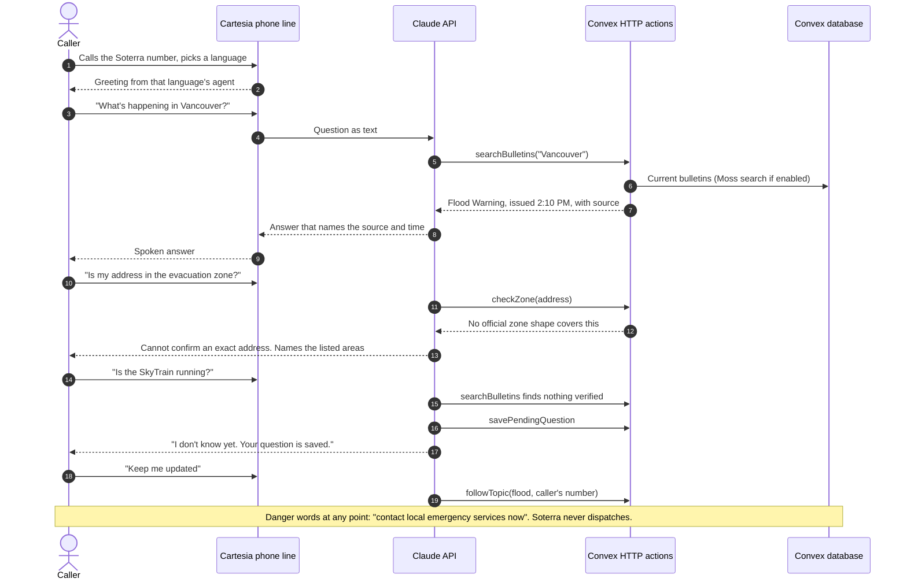
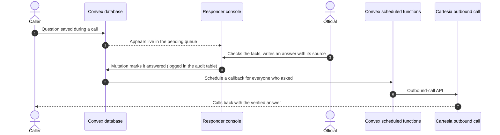
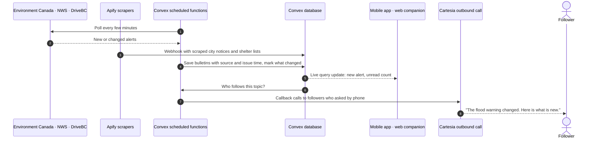

# Soterra: every feature and the real system behind it

Soterra is an emergency information service. People ask questions about an emergency, such as a flood, and Soterra answers only from official, timestamped bulletins. When it does not know something, it says so instead of guessing, and it calls people back when the news changes.

The full project has four ways in:

1. **The phone hotline.** Anyone can call from any phone. No app or data plan is needed. This is the main product.
2. **The mobile app** (iOS). It is the original prototype, and the web companion copies its look.
3. **The web companion** (this repository). It runs in a browser on a phone, tablet or laptop.
4. **The responder console.** Officials and operators use it to publish bulletins and answer questions Soterra could not answer.

This document lists every feature, names the technology each one uses in the real build, and shows the whole system in diagrams.

> **How to read this.** "Today" means the hackathon demo in this repository, where everything is fictional and runs in the browser. "Real" means the planned build: Cartesia for the phone line, the Claude API for answers, Convex for the backend, official feeds from Environment Canada, DriveBC and the US National Weather Service, with Moss and Apify as lower-priority prize-track additions. Anything the plan has not chosen yet is marked **not chosen yet**.

---

## 1. The whole system

How to read the picture, top to bottom:

1. **People** (grey) pick a way in. Residents, callers and household members use the phone hotline, the mobile app or the web companion. Responders sign in to the console.
2. **Apps** (blue) show each app's own stack as logos:
   - **Mobile app:** iOS and Swift, with Convex's Swift client.
   - **Web companion:** Next.js, React, Tailwind, Radix, Zustand, Leaflet and turf.js.
   - **Responder console:** Next.js with Convex.
3. **A phone call** (orange) goes to the **Cartesia phone line**. Cartesia handles the number, the speech recognition, the turn-taking and the spoken voice. Managed Agents take one language each, so there is one agent per language. Cartesia passes the question as text to **Claude**.
4. **Claude** answers only from what its tools return. Its tools are **Convex HTTP actions**: search bulletins, save a pending question, follow a topic, check a zone, log the call. If nothing verified comes back, it says "I don't know yet" and the question becomes a pending question. If the caller is in danger, it tells them to call 911 now. Soterra never dispatches anyone.
5. **Convex** (green) is the whole backend:
   - **Queries and mutations** push live data to every open app.
   - **Scheduled functions** poll the feeds and place **callback calls** through Cartesia's outbound-call API when news changes.
   - **turf.js** checks a point against official zone shapes, and only those.
   - **Moss** is optional very fast search for the voice agent.
6. **Official data** (pink) comes in from Environment Canada, the US National Weather Service and DriveBC. **Apify** scrapers cover sources with no feed, such as city notices and shelter lists. Soterra answers only from this data.

The picture is an SVG file ([`docs/architecture.svg`](architecture.svg), with a PNG copy at [`docs/architecture.png`](architecture.png)) because plain Mermaid diagrams on GitHub cannot show company logos. The diagrams below use Mermaid, so they stay editable as text.

### The short version

---

## 2. What happens on a call

## 3. How an unanswered question gets answered

## 4. How official news gets in and goes out

---

## 5. Every feature, and what it uses in the real build

### 5.1 Across the whole web companion

| Feature                           | What it does, in plain words                                                                                 | Today (demo)              | Real build                                                          |
| --------------------------------- | ------------------------------------------------------------------------------------------------------------ | ------------------------- | ------------------------------------------------------------------- |
| Responsive layout                 | Bottom tabs on phones and tablets; a left sidebar on laptops; two columns on Home and two panes on Map       | Next.js + Tailwind CSS    | Same                                                                |
| Light, dark and system themes     | Follows the device or your choice                                                                            | CSS color tokens          | Same                                                                |
| Larger text                       | Makes all text 25% bigger                                                                                    | Root font size            | Same                                                                |
| Reduce animations                 | Turns off motion and the pulsing marker                                                                      | CSS                       | Same                                                                |
| Accessibility                     | Skip link, keyboard use, screen reader labels, correct language tags on translated text, 44 px touch targets | Radix UI, axe tests       | Same, plus testing with real screen-reader users                    |
| Saved data                        | What you follow, your calls and your household plan                                                          | localStorage, via Zustand | Convex database, read with live queries; Zustand keeps screen state |
| Reset and Clear                   | Restore the sample data, or wipe it                                                                          | Demo buttons              | "Delete my data" as a Convex mutation                               |
| Unreadable-data notice            | Starts fresh and says so if saved data is broken                                                             | Built                     | Same for the offline copy                                           |
| Banners                           | Short messages at the top, such as "Now following"                                                           | Built                     | Same; push notifications are **not chosen yet**                     |
| Trust footer and Demo data labels | Says Soterra does not replace emergency services                                                             | Built                     | Same, plus "Official source" labels on real bulletins               |
| Privacy                           | No tracking, no cookies, no location, no microphone                                                          | Built                     | Privacy notice and consent for call transcripts                     |

### 5.2 Home

| Feature                          | What it does                                                                            | Today              | Real build                                                                                       |
| -------------------------------- | --------------------------------------------------------------------------------------- | ------------------ | ------------------------------------------------------------------------------------------------ |
| Your location line               | Shows the area you chose                                                                | Fixed text         | Area picker saved in Convex (never live GPS without consent)                                     |
| Top alert card                   | The most important alert: severity, how fresh it is, summary, View details, Ask Soterra | Seed data          | Convex live query over bulletins from the official feeds                                         |
| Hotline card                     | Call button for the hotline                                                             | Placeholder number | The Cartesia phone number                                                                        |
| Your next step                   | Shortcuts to Map and Household check-ins                                                | Built              | Same                                                                                             |
| Following list                   | Topics you follow, when last checked, new update counts                                 | Local              | Convex subscriptions table, live                                                                 |
| Recent calls                     | Your two latest calls                                                                   | Local              | Calls logged by the agent's logCall tool                                                         |
| Call Soterra / Return to Soterra | Starts or reopens the in-app assistant                                                  | Scripted assistant | Typed questions sent to a Convex action that calls Claude with the same tools as the phone agent |

### 5.3 Alerts

| Feature                | What it does                                                           | Today       | Real build                                                                                                         |
| ---------------------- | ---------------------------------------------------------------------- | ----------- | ------------------------------------------------------------------------------------------------------------------ |
| Following and All tabs | Switch between what you follow and every alert                         | Built       | Same                                                                                                               |
| Alert cards            | Title, area, summary, severity (Warning, Advisory, Watch), last update | Seed data   | Bulletins from Environment Canada, NWS and DriveBC via Convex scheduled functions; Apify for sources without feeds |
| Information requests   | Questions Soterra could not answer, pending or answered                | Local list  | Convex pending-questions table, answered in the responder console                                                  |
| Simulate follow-up     | Pretends an answer arrived                                             | Demo button | Replaced by real answers from the console                                                                          |

### 5.4 Alert detail

| Feature                    | What it does                                                                                   | Today            | Real build                                                                 |
| -------------------------- | ---------------------------------------------------------------------------------------------- | ---------------- | -------------------------------------------------------------------------- |
| What we know               | The bulletin summary                                                                           | Seed text        | Official bulletin text                                                     |
| Recommended actions        | What officials advise, plus "if you are in immediate danger, contact local emergency services" | Seed text        | Guidance from the feed or added in the console                             |
| Affected locations         | Areas named in the bulletin; says exact address matching is unavailable                        | Seed list        | Official area shapes from the feeds; turf.js zone check only against those |
| Updates timeline           | Every change, newest first                                                                     | Seed             | Bulletin versions stored in Convex                                         |
| Source card                | Who issued it and when                                                                         | Fictional source | Real issuer, issue time and a link to the official notice                  |
| Ask about this alert       | Asks the assistant about this alert                                                            | Scripted         | Claude with this bulletin returned by searchBulletins                      |
| Follow or unfollow updates | Get told when it changes                                                                       | Local            | Convex subscription; callbacks by Cartesia outbound call                   |

### 5.5 Following feed

| Feature                             | What it does                                 | Today | Real build                                  |
| ----------------------------------- | -------------------------------------------- | ----- | ------------------------------------------- |
| Updates for one followed topic      | Every change to that topic, newest first     | Local | Convex live query                           |
| Mark as read                        | Clears the new-update count when you open it | Local | Convex mutation, synced across your devices |
| View alert, Unfollow (with confirm) | Jump to the alert or stop following          | Built | Convex mutation                             |

### 5.6 The assistant and the call

| Feature                         | What it does                                                                 | Today               | Real build                                                                                                           |
| ------------------------------- | ---------------------------------------------------------------------------- | ------------------- | -------------------------------------------------------------------------------------------------------------------- |
| Real phone call                 | Call the hotline from any phone                                              | Placeholder number  | Cartesia phone number and Managed Agent                                                                              |
| Five languages                  | English, French, Spanish, Mandarin, Punjabi                                  | Pre-written answers | One Cartesia Managed Agent per language; check Punjabi speech recognition quality                                    |
| Switch language mid-call        | "Can you speak French?"                                                      | Built               | Hand the caller to the other language's agent, or call back in that language (Managed Agents take one language each) |
| Sources on every answer         | "Source: Demo flood bulletin"                                                | Built               | Claude cites what searchBulletins returned                                                                           |
| Refuses to guess addresses      | Will not say whether your exact address is in a zone                         | Keyword rules       | checkZone tool with turf.js against official shapes only; otherwise no answer                                        |
| Pending questions               | Unknown questions are saved, never guessed                                   | Keyword rules       | Claude calls savePendingQuestion when tools return nothing verified                                                  |
| Keep me updated                 | Follows the topic from inside the call                                       | Built               | followTopic tool                                                                                                     |
| Danger path                     | "I'm trapped" gets: call 911 now, plus a 911 button; Soterra cannot dispatch | Built               | Same rule in the agent's instructions, checked before any other answer; reviewed in every language                   |
| Fast replies                    | Answers quickly enough for a phone call                                      | Instant (scripted)  | Claude Haiku 5.5 for call turns; compare latency with Sonnet 5.5                                                     |
| Call screen, compact bar, timer | In-app call that keeps running when minimized                                | Built               | Same, for typed questions                                                                                            |
| Status line                     | Ready, Checking, Speaking                                                    | Built               | Same                                                                                                                 |
| Transcript and update cards     | Your questions, Soterra's answers, live updates                              | Built               | Convex live query on the call record                                                                                 |
| Suggested questions             | Tappable chips that change with the topic                                    | Built               | Same rules, or generated from current bulletins                                                                      |
| Read aloud                      | Speaks answers with the device's voices                                      | Browser speech      | Same in the browser; on the phone line, Cartesia's voice                                                             |
| End call and summary            | Saves a summary and (if allowed) the transcript                              | Built               | logCall tool writes the call and summary to Convex                                                                   |
| Callbacks                       | Soterra calls or texts you when news changes, on a schedule, or when a question is answered | Not in demo         | Convex scheduled functions call Cartesia's outbound-call API; texts by Twilio                                        |

### 5.7 History

| Feature                      | What it does                        | Today         | Real build                                                      |
| ---------------------------- | ----------------------------------- | ------------- | --------------------------------------------------------------- |
| Call list                    | Topic, date, length, language       | Local         | Convex calls table                                              |
| Call detail                  | Summary and transcript with sources | Local         | Same, with retention rules                                      |
| Delete a call                | Removes it (with confirm)           | Local         | Convex mutation                                                 |
| Save call transcripts switch | Keep only the summary if off        | Local setting | Consent stored in Convex; logCall skips the transcript when off |

### 5.8 Household

| Feature                   | What it does                                                                        | Today            | Real build                                                     |
| ------------------------- | ----------------------------------------------------------------------------------- | ---------------- | -------------------------------------------------------------- |
| Summary                   | "1 of 4 at a meeting point", how many are awaiting check-in                         | Local            | Convex live query                                              |
| Shared meeting point      | Choose a shelter or public meeting point; see the walk time; open on Map            | Local            | Convex places and households tables                            |
| Your people               | Members, role, status, last update, where they are meeting                          | Local, fictional | Members in Convex; everyone in the household sees changes live |
| Stale check-in warning    | Flags check-ins older than 30 minutes                                               | Built            | Same; reminder by push or SMS is **not chosen yet**            |
| Awaiting check-ins only   | Filter to people who have not checked in                                            | Built            | Same                                                           |
| Change status             | Reviewing the plan, Checking in, On my way, At the meeting point, Awaiting check-in | Local            | Convex mutation                                                |
| Add, edit, remove members | Name, role, status, meeting point                                                   | Local            | Convex mutations; invites by SMS **not chosen yet**            |
| Simulate check-in         | Pretends a member checked in                                                        | Demo button      | Real check-ins from members' apps                              |
| Message preview           | Text you could send to your household                                               | Never sent       | Sending by SMS is **not chosen yet**                           |

### 5.9 Map

| Feature            | What it does                                                                                                                              | Today                         | Real build                                                                                         |
| ------------------ | ----------------------------------------------------------------------------------------------------------------------------------------- | ----------------------------- | -------------------------------------------------------------------------------------------------- |
| Search and filters | Search names, areas and services; show Shelters, Water, Charging, Meeting points, Closures; Step-free, Pet-friendly, Saved only; Show all | Built                         | Same, over the Convex places table                                                                 |
| Offline diagram    | A drawing of the area that works with no internet: places, affected area, creek, closed bridge, routes; zoom, drag, keyboard              | Fictional drawing             | Same idea for the real area                                                                        |
| Street map         | Real streets from OpenStreetMap, only after you choose it; falls back if tiles fail                                                       | Leaflet + OpenStreetMap tiles | Same                                                                                               |
| Zone check         | Is this point inside an official zone?                                                                                                    | Not in demo                   | turf.js point-in-polygon against official shapes only                                              |
| Accessible list    | Every place as a list, grouped by type                                                                                                    | Built                         | Same                                                                                               |
| Place detail       | Hours, step-free, pets, capacity bar, services, when availability was checked, "Needs reconfirming" if old                                | Fictional                     | Shelter lists from Apify or city data, capacity updated in the console, with a real freshness time |
| Preview walk       | Step-by-step walking route that avoids closures; step-free option                                                                         | Hand-made street graph        | Walking-route engine **not chosen yet**                                                            |
| Save place         | Keep a place for later                                                                                                                    | Local                         | Convex mutation                                                                                    |
| Compare shelters   | Ranks shelters by space for your party size, step-free and pet needs, walk time, and how fresh the information is                         | Built over fictional data     | Same ranking over live capacity                                                                    |
| Simulated position | A marker for the demo starting point                                                                                                      | Fixed point                   | A chosen address, or location only with clear consent                                              |

### 5.10 Settings and About

| Feature      | What it does                                                                             | Today          | Real build                                                  |
| ------------ | ---------------------------------------------------------------------------------------- | -------------- | ----------------------------------------------------------- |
| Language     | Language for new calls                                                                   | Local          | Saved in Convex; picks the matching Cartesia agent          |
| Display      | Theme, larger text, reduce animations                                                    | Built          | Same                                                        |
| Voice        | Read replies aloud; shows which voices this device has                                   | Browser speech | Same                                                        |
| Privacy      | Save call transcripts switch                                                             | Local          | Consent stored in Convex                                    |
| Hotline      | Shows the number                                                                         | Placeholder    | The Cartesia number                                         |
| Demo actions | Simulate alert update, new warning, household check-in, resolve a question; Reset; Clear | Demo only      | Removed from the public app; a test mode for drills instead |
| About        | What is fictional, and what talks to the internet                                        | Built          | Real privacy notice and contacts                            |

### 5.11 Mobile app

The mobile app is the original iOS prototype; the web companion was built to match its look. It shares the companion features above: alerts, the assistant, map, household, history and settings. In the real build it reads and writes the same Convex data through Convex's Swift client, and its Call button dials the Cartesia number.

The web build's brief also lists features the prototype has that the web companion leaves out:

| Feature (mobile prototype)   | What it does                                    | Real build                                          |
| ---------------------------- | ----------------------------------------------- | --------------------------------------------------- |
| Neighbour meetup groups      | Groups of neighbours meeting at the same place  | Convex tables, with moderation and privacy controls |
| Activity centre              | One place for recent activity and notifications | Convex live query over your updates                 |
| Preparedness checklist       | Things to prepare before an emergency           | Content managed by officials                        |
| Guided demo checklist        | Walks a presenter through the demo              | Demo only                                           |
| Simulated walking journey    | Animates walking a route                        | Demo only                                           |
| Recording player             | Plays back call audio                           | Stored recordings **not chosen yet**                |
| Notification permission flow | Asks to allow notifications                     | Push notifications **not chosen yet**               |
| Native phone call hand-off   | Tapping Call opens the phone dialer             | Dials the Cartesia number                           |

> I have not seen the mobile app's code. This table comes from the web build's brief, which names the prototype's features in its "out of scope" list.

### 5.12 Responder console

A separate Next.js web app for officials, on the same Convex backend. Its features below are the ones the rest of the system depends on.

| Feature                    | What it does                                                                        | Real build                                               |
| -------------------------- | ----------------------------------------------------------------------------------- | -------------------------------------------------------- |
| Sign in with roles         | Only approved officials and operators get in; roles decide who can publish          | Convex authentication with roles                         |
| Bulletin desk              | See incoming feed items, publish or correct a bulletin, add timeline updates        | Convex mutations; every change written to an audit table |
| Pending questions queue    | See questions Soterra could not answer; write a verified answer with its source     | Convex live query and mutation                           |
| Callback control           | Answers and bulletin changes go out to everyone who asked or follows                | Convex scheduled functions and Cartesia outbound calls   |
| Shelter and capacity board | Update shelter open or closed, capacity and services, which sets the freshness time | Convex mutation on the places table                      |
| Live dashboard             | What people are asking, in which languages, how many calls                          | Convex live queries over calls and questions             |
| Audit trail                | Who published or answered what, and when                                            | Convex audit table                                       |

---

## 6. The full tech stack

| Layer                      | Today (this repository)                                                           | Real build                                                                                                                  | Priority                    |
| -------------------------- | --------------------------------------------------------------------------------- | --------------------------------------------------------------------------------------------------------------------------- | --------------------------- |
| Phone line and voice       | None (placeholder number)                                                         | Cartesia Line SDK and Managed Agents: number, speech to text, voice, one agent per language, outbound calls                 | Riskiest piece; learn first |
| Answers                    | Rule-based engine with pre-written answers                                        | Claude API with tool use: answers only from tool results, otherwise "I don't know yet". Haiku 5.5 vs Sonnet 5.5 for latency | Core                        |
| Backend and data           | None (browser storage)                                                            | Convex: database, queries, mutations, scheduled functions, HTTP actions for the agent's tools                               | Core                        |
| Web companion              | Next.js 16, React 19, TypeScript, Tailwind CSS 4, Radix UI, Zustand, lucide icons | Same, reading from Convex                                                                                                   | Core                        |
| Responder console          | Not in this repository                                                            | Next.js, React, Tailwind, Radix, on Convex                                                                                  | Core                        |
| Mobile app                 | iOS prototype                                                                     | iOS (Swift) with Convex's Swift client                                                                                      | Core                        |
| Official data              | Seed file                                                                         | Environment Canada, DriveBC and US National Weather Service feeds, polled by Convex scheduled functions                     | Core                        |
| Scraping                   | None                                                                              | Apify for sources with no feed (city notices, shelter lists), sent to Convex by webhook                                     | Prize track, lower priority |
| Search                     | None                                                                              | Moss for very fast semantic search over bulletins during calls; Convex search otherwise                                     | Prize track, lower priority |
| Maps                       | Hand-drawn diagram; Leaflet with OpenStreetMap tiles on request                   | Same                                                                                                                        | Only for the street map     |
| Zone check                 | None                                                                              | turf.js point-in-polygon against official shapes                                                                            | Only for the zone check     |
| Walking routes             | Hand-made street graph                                                            | **Not chosen yet**                                                                                                          |                             |
| Push notifications and SMS | On-screen banners                                                                 | Push **not chosen yet**; SMS for updates by **Twilio** (update texts, missed-call texts, call recaps; see docs/backend.md)   |                             |
| Hosting for the web apps   | Local                                                                             | **Not chosen yet** (Convex hosts the backend)                                                                               |                             |
| Testing                    | Vitest, Testing Library, Playwright, axe                                          | Same, plus test calls in every language                                                                                     |                             |

### What to learn first

1. **Cartesia (the phone line).** This is the riskiest piece. Read the Line SDK and Managed Agents docs; Managed Agents currently take one language per agent. Build a "hello world" voice agent with a phone number, test the outbound-call API that callbacks depend on, and check Punjabi speech recognition quality.
2. **Claude API with tool use.** Practise the pattern where the model answers only from tool results and says "I don't know yet" otherwise. Compare Haiku 5.5 with Sonnet 5.5 for call latency.
3. **Convex.** Queries, mutations, scheduled functions and HTTP actions. HTTP actions are how the agent's tools call the backend.
4. **Next.js, React and Tailwind.** Mostly review, plus Radix Dialog and Zustand for anyone new to them.
5. **Official data feeds.** Look at the formats from Environment Canada, DriveBC and the US National Weather Service, and check whether any need keys.
6. **Moss and Apify.** Skim the docs and get free accounts. Both are prize-driven and lower priority.
7. **Leaflet and turf.js.** Only needed for the street map and the zone check.

---

## 7. Rules that do not change from demo to real

- Every answer shows its source and its time.
- Soterra never guesses whether an exact address is in an evacuation zone. A zone check only answers against official shapes.
- Questions without a verified answer become pending questions, never invented answers.
- Danger wording always leads to "contact local emergency services now". Soterra never says or implies it sent help.
- Soterra never claims a shelter is open unless an official source says so, with how fresh that information is.
